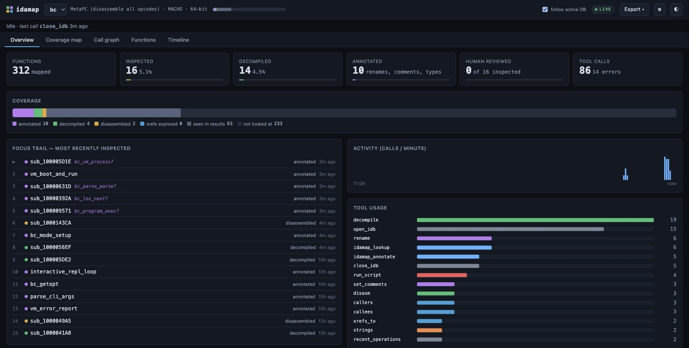
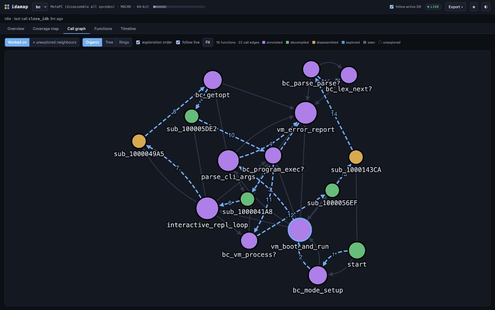
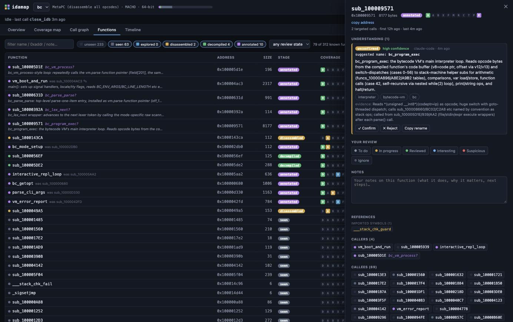
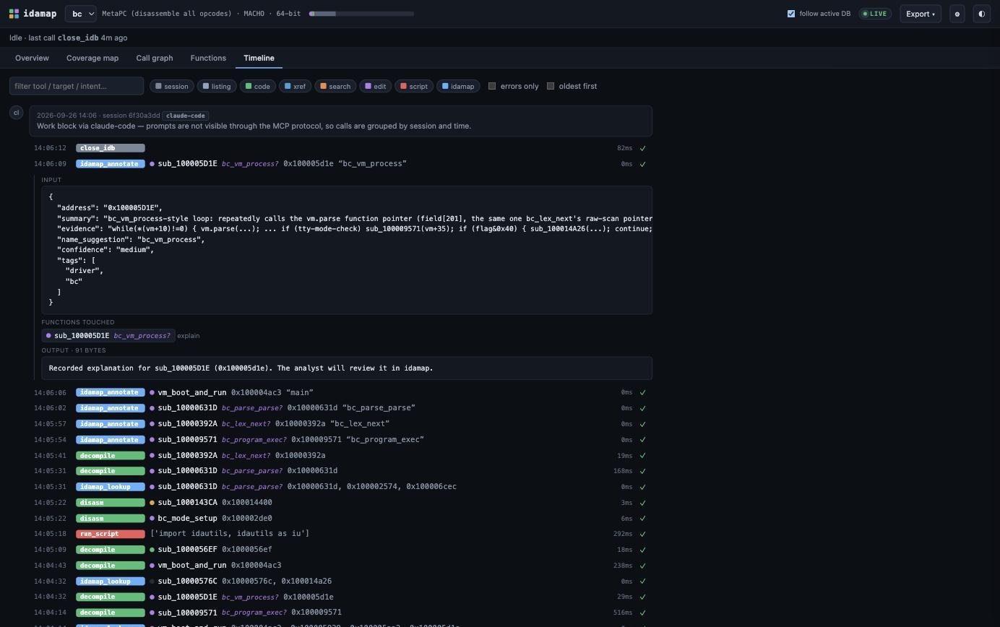
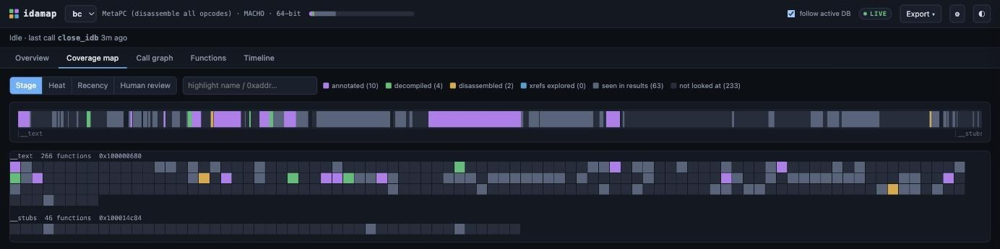

# idamap

**See what your LLM is doing in IDA.** idamap records every [ida-mcp](https://github.com/blacktop/ida-mcp-rs)
tool call your LLM makes and turns it into a live, browsable map of the reverse-engineering work: what was
looked at, what is running right now, why, and what is still unexplored.

Works with **any MCP client** — Claude Code, Cursor, Codex, Claude Desktop, VS Code / Copilot, Gemini CLI,
Windsurf, Zed, Cline, … — through a transparent proxy, with no changes to ida-mcp or IDA.

> Türkçe: [README.tr.md](README.tr.md)



## Why

An LLM driving IDA through MCP fires several tool calls per second. The terminal scroll is impossible to follow,
the model's understanding of a function disappears when the conversation ends, and the next session starts from
scratch. idamap keeps a durable corpus of that work and shows it:

| View | What it answers |
|---|---|
| **Now bar** | Which tool is running, on which function, from which client, for how long |
| **Coverage map** | Which parts of the binary were reversed: an IDA-style address band plus one tile per function, coloured by how deep the analysis went, by call count, by recency or by your review status |
| **Call graph** | The functions worked on, the order the LLM explored them in, and the unexplored neighbours that are the natural next candidates |
| **Functions** | Sortable, searchable table (names, demangled names, explanations, coverage, review status) |
| **Timeline** | Your prompt → what the model said it was about to do → the calls it made, with inputs and outputs |
| **Function panel** | Renames, comments, LLM explanations, referenced strings / selectors / classes / imports, callers / callees, latest pseudocode, full history, and your own review status and notes |

<table>
<tr><td></td>
<td></td></tr>
<tr><td></td>
<td></td></tr>
</table>

Coverage stages: `seen` (appeared in a result) → `explored` (xrefs / callers / callees) → `disassembled` →
`decompiled` → `annotated` (renamed, commented, typed, patched or explained).

## Install

Python ≥ 3.10, no dependencies (the UI's graph library is vendored; everything works offline).

```sh
uv tool install git+<repository-url>      # or: pipx install … / pip install …
idamap serve --open                        # http://127.0.0.1:8777
```

From a checkout: `uv tool install -e .`

## Connect your MCP client

### Any client: the proxy

Replace the command your client uses to start ida-mcp with `idamap proxy -- ida-mcp`. Print ready-made,
absolute-path configurations (GUI apps don't inherit your shell `PATH`):

```sh
idamap mcp-config                     # all clients
idamap mcp-config --client cursor     # claude-code | cursor | claude-desktop | windsurf | gemini | vscode | codex | http
```

Cursor (`~/.cursor/mcp.json`), Claude Desktop, Windsurf and Gemini CLI use this shape:

```json
{ "mcpServers": { "ida": { "command": "/Users/you/.local/bin/idamap",
                           "args": ["proxy", "--", "/opt/homebrew/bin/ida-mcp"] } } }
```

Codex (`~/.codex/config.toml`):

```toml
[mcp_servers.ida]
command = "/Users/you/.local/bin/idamap"
args = ["proxy", "--", "/opt/homebrew/bin/ida-mcp"]
```

Existing ida-mcp arguments (`--workspace`, `--read-only`, …) go after the ida-mcp path.

Clients that connect over HTTP: put the proxy in front of `ida-mcp serve-http` and point the client at the proxy:

```sh
ida-mcp serve-http --bind 127.0.0.1:8765
idamap proxy --listen 127.0.0.1:8766 --upstream http://127.0.0.1:8765/
```

The proxy forwards bytes first and observes on the side; recording runs on its own thread. A parsing or database
problem never delays or alters the MCP stream (errors go to `~/.idamap/proxy_errors.log`). If ida-mcp exits, the
proxy exits with the same code and records in-flight calls as failed.

### Claude Code: hooks (richer)

```sh
idamap install                        # adds hooks to ~/.claude/settings.json
idamap install --scope project --project-dir /path/to/research   # one project only
```

Restart Claude Code afterwards. Hooks additionally capture **your prompt** and **what the model wrote right before
each call** (from the transcript), which the MCP protocol does not carry. Without hooks, prompt-less sessions are
grouped into work blocks by session and idle time.

Hooks and the proxy can be used together: Claude Code sends its tool-use id in the request `_meta`, so each call
is recorded once. Remove hooks with `idamap uninstall`; check state with `idamap status`.

## Map the whole binary

By default idamap only knows the functions the LLM happened to touch. To map everything — all functions, call
edges, segments, demangled names, and what each function references — ask the LLM to run:

```
run_script(file="<path printed by: idamap export-script>")
```

Only one summary line returns to the model; idamap imports the JSON automatically. From the IDA GUI:
File › Script file…, then `idamap import <json>`.

## LLM explanations (optional)

```sh
idamap config annotate_tools on       # or per client: idamap proxy --annotate-tools -- ida-mcp
```

The proxy then offers the model two extra tools, answered by idamap itself (never sent to ida-mcp, nothing is
written to the IDA database):

- **`idamap_annotate`** — after analyzing a function, the model records a summary, a suggested name, tags, the
  library / SDK / framework it belongs to, a confidence level and the evidence.
- **`idamap_lookup`** — before digging in, the model reads what is already known: earlier explanations (and
  whether you confirmed or rejected them), your notes, renames, references, callers and callees.

Explanations are stored as **unconfirmed hypotheses**. You confirm or reject them in the function panel;
confirmed ones are marked as such in the report, the IDA sync script and later lookups. Because the knowledge
lives in idamap, it carries over between sessions and between different clients.

Settings are also available in the UI (⚙). Optional features are off by default.

## Export

- **Markdown research log** (`Export` menu, or `idamap report <db-id>`): coverage summary, functions worked on,
  LLM explanations, renames, comments and the prompt → intent → call timeline.
- **IDA coverage sync script** (`Export` menu, or `idamap ida-sync <db-id>`): run it in the IDA GUI to colour
  functions by coverage stage and add an `[idamap]` function comment with the summary, your notes and the LLM
  explanation. `CLEAR = True` removes everything it added.

## How it works

```
any MCP client ──▶ idamap proxy ──▶ ida-mcp
                      │ queue + recorder thread
Claude Code ──hooks──▶ idamap hook ──┴──▶ ~/.idamap/idamap.db (SQLite, WAL)
                                                 ▲ poll
                                   idamap serve ──SSE──▶ browser
```

Each call's input and output are parsed into facts: function records, call edges, xrefs, string references,
renames, comments, segments, database metadata. ida-mcp's single-target (plain payload) and batch
(`{"results": [...]}`) response shapes are both understood. Targets that are not known functions yet are kept as
stubs and merged once the real function appears. Multiple databases are tracked per session, including
ida-mcp `--workspace` `database_id`s. Records are **per binary**: another IDB of the same input (same SHA-256)
continues the same record. Addresses are 64-bit safe (e.g. iOS kernelcache addresses).

Tested with a 115k-function iOS app (385k call edges): full-map export ≈ 23 s in IDA, UI stays interactive.

## Security and privacy

- Everything stays on your machine: `~/.idamap/` (override with `IDAMAP_HOME`). idamap makes no network requests.
- The UI binds to `127.0.0.1`. It has no authentication, so it rejects requests with foreign `Host` headers
  (DNS rebinding) and cross-origin or non-JSON writes. `idamap serve --host 0.0.0.0` exposes your research data
  and code snippets to your network; it prints a warning.
- The database contains tool outputs (pseudocode, strings) from the binaries you analyze. Treat it like the
  IDA database itself.

## Troubleshooting

| Symptom | Fix |
|---|---|
| Nothing appears | `idamap status`; restart the MCP client after changing its config; check `~/.idamap/*_errors.log` |
| Client can't start the server | use absolute paths (`idamap mcp-config` prints them) |
| Client shows as `mcp-client` | the client sent no `clientInfo`; set a label with `idamap proxy --harness myclient -- ida-mcp` |
| Calls recorded twice | update to ≥ 0.2.0 (hook + proxy de-duplication) |
| Coverage only shows a few functions | import the full map (see above) |

## Development

```sh
python -m unittest discover -s tests -t .
```

Tests use real ida-mcp outputs, real Claude Code hook payloads, and fake stdio / Streamable-HTTP (SSE) MCP
servers to check that the proxy is byte-transparent.

## License

MIT. `idamap/web/vendor/cytoscape.min.js` is Cytoscape.js (MIT, © The Cytoscape Consortium).
