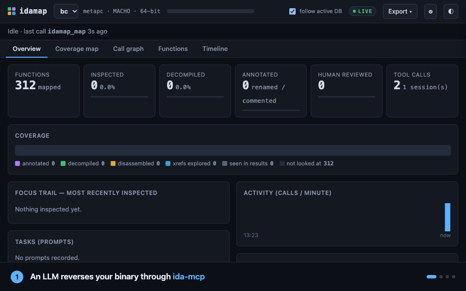

# idamap

**LLM'in IDA'da ne yaptığını gör.** idamap, LLM'in [ida-mcp](https://github.com/blacktop/ida-mcp-rs) üzerinden
yaptığı her tool çağrısını kaydeder ve reverse engineering çalışmasını canlı bir haritaya dönüştürür: nelere
bakıldı, şu an ne çalışıyor ve neler hâlâ keşfedilmedi.

> [!IMPORTANT]
> **Önce [ida-mcp-rs](https://github.com/blacktop/ida-mcp-rs)'i kur.** idamap onu içermez ve kurmaz: yalnızca
> ida-mcp'nin önünde bir proxy olarak durur. ida-mcp-rs'i (ve gerektirdiği şeyleri, örneğin IDA Pro) onun README'sini
> izleyerek kur ve idamap'i eklemeden önce tek başına çalıştığından emin ol.

<p align="center"></p>
<p align="center"><sub>Gerçek bir oturum (Claude Code, ida-mcp üzerinden macOS'in açık kaynak <code>bc</code>'sini inceliyor), hızlandırılmış tekrar.</sub></p>

Bağımsız bir projedir; blacktop veya Hex-Rays ile bağlantılı değildir ve onlar tarafından onaylanmamıştır.
English: [README.md](README.md)

## Neden

MCP üzerinden IDA'yı kullanan bir LLM saniyede birkaç çağrı yapar, bir fonksiyon hakkında anladığı şey sohbet
bitince kaybolur ve bir sonraki oturum sıfırdan başlar. idamap bu çalışmanın kalıcı bir kaydını tutar:

- **Kapsama haritası**: hangi fonksiyonlar, ne kadar derin reverse edildi (`seen` → `explored` → `disassembled` →
  `decompiled` → `annotated`); ayrıca canlı "şu an" çubuğu ve aranabilir fonksiyon tablosu.
- **Çağrı grafiği**: üzerinde çalışılan fonksiyonlar, gezilme sırası ve keşfedilmemiş komşular.
- **Zaman çizelgesi**: senin prompt'un → modelin yapacağını söylediği → yaptığı çağrılar (girdi ve çıktılarıyla).
- **Fonksiyon paneli**: rename'ler, yorumlar, LLM açıklamaları, referans verilen string / import'lar, caller /
  callee'ler, kendi inceleme durumun ve notların.

## Kurulum

Python ≥ 3.10 gerekir (başka bağımlılık yok) ve çalışan bir [ida-mcp-rs](https://github.com/blacktop/ida-mcp-rs).

```sh
uv tool install git+https://github.com/RavenT1/idamap      # veya: pipx install git+https://github.com/RavenT1/idamap
idamap serve --open                                         # http://127.0.0.1:8777
```

## MCP istemcini bağla

İstemcinin ida-mcp'yi başlattığı komutu `idamap proxy -- ida-mcp` ile değiştir. `idamap mcp-config` mutlak yollu hazır
ayarları yazar (`--client claude-code | cursor | claude-desktop | windsurf | gemini | vscode | codex | http`):

```json
{ "mcpServers": { "ida": { "command": "/Users/you/.local/bin/idamap",
                           "args": ["proxy", "--", "/opt/homebrew/bin/ida-mcp"] } } }
```

Mevcut ida-mcp argümanların (`--workspace`, `--read-only` …) ida-mcp yolundan sonra gelir. HTTP ile bağlanan
istemciler için proxy'yi `ida-mcp serve-http`'in önüne koy:

```sh
ida-mcp serve-http --bind 127.0.0.1:8765
idamap proxy --listen 127.0.0.1:8766 --upstream http://127.0.0.1:8765/
```

**Claude Code (isteğe bağlı, daha zengin):** `idamap install` `~/.claude/settings.json`'a hook ekler (Claude Code'u
yeniden başlat; `idamap uninstall` kaldırır). Hook'lar ayrıca senin prompt'unu ve modelin her çağrıdan önce
yazdığını yakalar; MCP bunları taşımaz. Hook ve proxy birlikte kullanılabilir, her çağrı bir kez kaydedilir.

## Tüm binary'yi haritala

idamap varsayılan olarak yalnızca LLM'in dokunduğu fonksiyonları bilir. Her şeyi haritalamak için (tüm fonksiyonlar,
call edge'leri, isimler ve her fonksiyonun referansları) LLM'e `run_script(file="<idamap export-script'in yazdığı
yol>")` çalıştırt, ya da o script'i IDA GUI'de çalıştırıp `idamap import <json>` yap. Aşağıdaki araçlar açıkken
idamap bunu kendisi yapar.

## LLM'e gezinmede yardım (isteğe bağlı, varsayılan kapalı)

```sh
idamap config annotate_tools on       # veya tek istemci için: idamap proxy --annotate-tools -- ida-mcp
```

idamap, ida-mcp'nin MCP cevaplarına dört araç ve kısa bir kullanım notu ekler; araçları kendi yerel veritabanından
kendisi yanıtlar (IDA veritabanına hiçbir şey yazılmaz). Ayarı değiştirdikten sonra MCP istemcisini yeniden başlat.

- **`idamap_search`**: isim, string, import, selector, class veya önceki açıklamaya göre kapsama farkındalıklı
  arama; istenirse yalnızca kimsenin üzerinde çalışmadığı fonksiyonlar.
- **`idamap_status`**: aşamaya göre kapsama, son bakılanlar, sıradaki yerler ve uygulama paketi.
- **`idamap_lookup`**: bir fonksiyonu analiz etmeden önce bilinenler: açıklamalar, notların, rename'ler, caller /
  callee'ler.
- **`idamap_annotate`**: fonksiyonu analiz ettikten sonra model özet, önerilen isim, etiket, güven seviyesi ve
  kanıtı kaydeder.

Açıklamalar **onaylanmamış hipotez** olarak saklanır; fonksiyon panelinde onaylar veya reddedersin, oturumlar ve
istemciler arasında taşınır. Modelin yazdığı notlar güvenilmeyen girdidir: kötü niyetli bir binary onları
yönlendirmeye çalışabilir; bu yüzden sen inceleyene kadar onaylanmamış kalırlar.

**Model bunları kullanıyor mu?** Overview'daki *Guidance followed* kartı, kayıtlı çağrılardan şunları sayar: oturum
kaç kez `idamap_status` ile başladı, bir fonksiyonu analiz etmeden önce `idamap_lookup` yaptı mı, analiz ettiğini
açıkladı mı, `idamap_search` kullandı mı ve zaten açıklanmış fonksiyonların kaçını aramadan yeniden analiz etti.
Bir skor değil, bir sayımdır; yalnızca araçların sunulduğu oturumları kapsar.

**Uygulama paketleri.** Bir `.app` / IPA içinde ilginç kod çoğu zaman bir framework'tedir. idamap `Info.plist` ve
`Frameworks/` dizinini okur, import edilen sembolleri onları sağlayan framework'e eşler ve modele kodun hangi
binary'de olduğunu, analiz edilip edilmediğini söyler.

**Otomatik indeksleme (`auto_map`, araçlar açıkken varsayılan açık).** Search ve status için tüm binary'nin
indekslenmesi gerekir; bu yüzden ihtiyaç duyan ilk çağrıda proxy, ida-mcp'ye salt-okunur tek bir `run_script`
gönderir (`~/.idamap/exports` altına tek bir JSON yazar; zaman çizelgesinde `idamap_map` olarak görünür).
idamap'in ida-mcp'ye kendiliğinden hiç istek göndermemesi için: `idamap config auto_map off`.

## Dışa aktarma

- **Markdown araştırma günlüğü**: `Export` menüsü veya `idamap report <db-id>`.
- **IDA kapsama senkron script'i**: `Export` menüsü veya `idamap ida-sync <db-id>`; fonksiyonları aşamasına göre
  boyar ve IDA'da `[idamap]` yorumu ekler. `CLEAR = True` geri alır.

## Nasıl çalışır

```
her MCP istemcisi ──▶ idamap proxy ──▶ ida-mcp
                         │ kuyruk + kayıt iş parçacığı
Claude Code ──hooks──▶ idamap hook ──┴──▶ ~/.idamap/idamap.db (SQLite)
                                                 ▲ poll
                                   idamap serve ──SSE──▶ tarayıcı
```

Proxy baytları önce iletir, kaydı yan kanalda yapar; ayrıştırma veya veritabanı hatası MCP trafiğini asla
geciktirmez ya da bozmaz. Kayıtlar **binary başınadır**: aynı girdinin (aynı SHA-256) başka bir IDB'si aynı kayda
devam eder.

## Güvenlik ve gizlilik

- Her şey senin makinende kalır (`~/.idamap/` veya `IDAMAP_HOME`). idamap ağa istek atmaz.
- Arayüz `127.0.0.1`'e bağlanır; yabancı `Host` başlıklarını ve başka kaynaklardan gelen yazma isteklerini reddeder.
  `idamap serve --host 0.0.0.0` araştırma verini ağına açar.
- Veritabanı, analiz ettiğin binary'lerden çıktılar (pseudocode, string'ler) içerir; IDA veritabanı gibi muamele et.

## Uyumluluk

| | Durum |
|---|---|
| macOS + ida-mcp-rs + **Claude Code**, **Codex CLI**, **omp** | gerçek oturumlarla uçtan uca test edildi |
| Linux, Python 3.10 ve 3.13 | birim testleri geçiyor (sahte ida-mcp); gerçek IDA ile test edilmedi |
| Windows | test edilmedi |
| Diğer MCP istemcileri (Cursor, Claude Desktop, VS Code, Gemini CLI, …) | çalışması beklenir (stdio ve Streamable HTTP üzerinden standart MCP), doğrulanmadı |
| Diğer IDA MCP sunucuları (mrexodia/ida-pro-mcp, Hex-Rays'in kendi sunucusu, …) | test edilmedi; araç adları farklı olabilir |

Diğer kurulumlar için geri bildirim ve düzeltmeler memnuniyetle karşılanır.

## Sorun giderme

| Belirti | Çözüm |
|---|---|
| Hiçbir şey görünmüyor | `idamap status`; ayar değişikliğinden sonra istemciyi yeniden başlat; `~/.idamap/*_errors.log` |
| İstemci sunucuyu başlatamıyor | mutlak yollar kullan (`idamap mcp-config` yazar) |
| İstemci `mcp-client` görünüyor | etiket ver: `idamap proxy --harness istemcim -- ida-mcp` |
| Kapsama birkaç fonksiyonla sınırlı | tüm binary'yi haritala (yukarıya bak) |

## Geliştirme ve teşekkür

`python -m unittest discover -s tests -t .` (sahte stdio ve Streamable-HTTP MCP sunucuları proxy'nin baytları
değiştirmediğini doğrular).

idamap, eşlik ettiği headless IDA Pro MCP sunucusu blacktop'un [ida-mcp-rs](https://github.com/blacktop/ida-mcp-rs)
projesi ve [Model Context Protocol](https://modelcontextprotocol.io) sayesinde var.

## Lisans

MIT. `idamap/web/vendor/cytoscape.min.js` Cytoscape.js'tir (MIT, © The Cytoscape Consortium).
